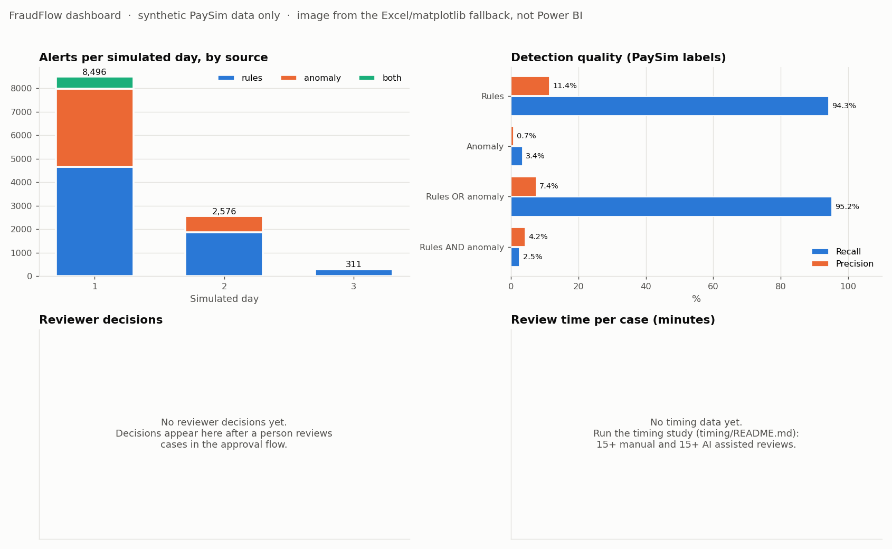
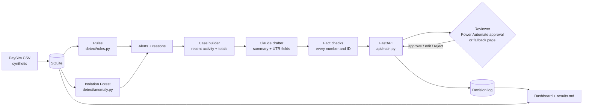

# FraudFlow

**An AI assisted fraud and anti money laundering (AML) alert review prototype.** Rules and anomaly detection flag suspicious transactions, an AI agent drafts the case summary and the main fields of an Unusual Transaction Report (UTR), automatic checks verify every fact in the draft, and **a person approves, edits or rejects every case.**

> **Synthetic data only.** FraudFlow uses the public PaySim simulation of mobile money transactions. No real customer data is used, requested or simulated. FraudFlow never files, closes or sends anything on its own.

**Live demo (read-only):** _deploying, link added when live_



## Architecture



## Results (from `outputs/results.md`, real runs only)

Detection, measured per transaction against PaySim's fraud labels. **Sample: 454,386 screened transactions (TRANSFER and CASH_OUT) out of 1,030,563 loaded from simulated days 1 to 3, containing 890 labelled fraud transactions.**

| Method | Alerts | Recall (fraud caught) | Precision | False alarms per 1,000 |
|---|---:|---:|---:|---:|
| Rules (any of 6) | 7,360 | 94.3% (839 / 890) | 11.4% | 14.4 |
| Isolation Forest | 4,544 | 3.4% (30 / 890) | 0.7% | 9.9 |
| Rules OR anomaly (review queue) | 11,383 | 95.2% (847 / 890) | 7.4% | 23.2 |
| Rules AND anomaly | 521 | 2.5% (22 / 890) | 4.2% | 1.1 |

* Three rule thresholds were revised once to bring alert volume down after a first run flagged 82% of transactions. The labels were visible during that revision, so these numbers are optimistic. The full story is in [docs/DETECTION_NOTES.md](docs/DETECTION_NOTES.md).
* **Drafting:** 20 alerts drafted and all 20 passed the automatic fact checks. These were made with the **no-AI template**, because no Claude API key was set when this ran; they show the pipeline working, not AI quality. All 20 are marked low confidence because PaySim senders almost never have earlier history.
* **Review decisions and timing study:** {not run yet}. Needs a person to review cases (15 manual + 15 AI assisted). See [timing/README.md](timing/README.md).

## Status

| Part | Status |
|---|---|
| Detection (6 rules, Isolation Forest, evaluation) | Done |
| Case builder, Claude drafter, fact checks, tests | Done. Claude call written and tested with a stand-in client; **real AI drafts need `ANTHROPIC_API_KEY`** |
| Review API and decision log | Done |
| Approval routing | **Fallback approval page** (`/review`), clearly labelled. **Power Automate flow designed but not yet built** ([flow/SETUP.md](flow/SETUP.md)) |
| Dashboard | **Excel fallback** and image built from pipeline data. **Power BI version not built yet** ([dashboard/POWERBI_SETUP.md](dashboard/POWERBI_SETUP.md)) |
| Timing study | Tooling done; **reviews not done yet** |
| Docs | [Use case](docs/USE_CASE.md), [risks](docs/RISKS.md), [investigator guide](docs/INVESTIGATOR_GUIDE.md), [primer](docs/PRIMER.md), [interview notes](docs/INTERVIEW_NOTES.md) |

## How to run

Python 3.11 or newer.

```bash
pip install -r requirements.txt
cp .env.example .env          # add ANTHROPIC_API_KEY for AI drafts; set FRAUDFLOW_API_KEY
python -m data.download_data  # about 490 MB, synthetic PaySim
python -m data.load_data      # loads simulated days 1-3 into data/fraudflow.db
python -m detect.evaluate     # flags, measures, saves alerts (about 2 minutes)
python -m agent.generate_drafts --count 20
uvicorn api.main:app --port 8000   # then open http://localhost:8000/review
python -m dashboard.build_dashboard
python -m pytest
```

Other commands: `python -m flow.smoke_test` (end-to-end API test on a copy of the database), `python -m timing.review_session --mode manual --reviewer "Name"`, `python -m timing.analyze`, `python -m showcase.build_demo_db` (rebuilds the small read-only demo database used by the live site).

## Repository layout

```
data/        download and load PaySim; small sample CSV; demo database for the live site
detect/      rules.py, anomaly.py, evaluate.py
agent/       case_builder.py, drafter.py, checks.py, generate_drafts.py
api/         FastAPI app and the fallback review page
flow/        Power Automate flow design, setup notes, API smoke test
timing/      timed review sessions and analysis
dashboard/   dashboard builder, Excel fallback, CSVs for Power BI, screenshots
showcase/    landing page and demo database builder for the Render site
docs/        primer, use case, risks, investigator guide, detection notes, interview notes
outputs/     results.md (written only by scripts) and example drafts
tests/       25 tests, including proof that invented IDs and numbers are caught
```

## Limitations

* **Synthetic data.** PaySim's fraud follows one fixed pattern (empty the account, pass the money through, cash out), which suits the rules; real fraud is messier. Almost every PaySim sender appears only once, so per-customer history is thin.
* **No held-out test period.** Thresholds and measurements use the same 3 days.
* **The Isolation Forest is weak here** (3.4% recall): in PaySim, unusual is not the same as fraud.
* **Fact checks verify numbers and IDs, not reasoning.** A draft can quote correct numbers and still tell the wrong story, which is why a person reviews every case.
* **Not yet done:** real AI drafts, Power Automate, Power BI, and the timing study. Do not claim these until they are run.

## Data credit

PaySim: E. A. Lopez-Rojas, A. Elmir and S. Axelsson, "PaySim: A financial mobile money simulator for fraud detection", EMSS 2016. Dataset: https://www.kaggle.com/datasets/ealaxi/paysim1 (downloaded via a public Hugging Face mirror).
